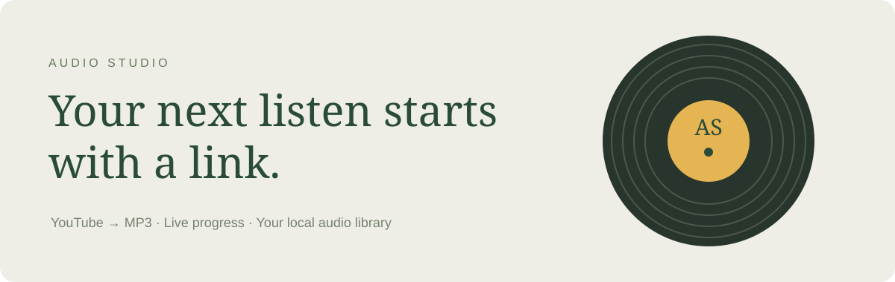

# Audio Studio



A local web app for turning a YouTube video into an MP3 and keeping a playable audio library. Paste a link, choose a bitrate, and follow the download and conversion progress. Playlist parameters are removed so only the selected video downloads.

## Start the web app

Requires Python 3.10+, FFmpeg, and Node.js or Deno. On macOS:

```sh
brew install ffmpeg node
python -m pip install -U --pre "yt-dlp[default]"
python -m webapp.server
```

Open http://127.0.0.1:8765. In the existing Miniconda environment, use `/Users/weizhang/miniconda3/bin/python` in place of `python`.

The app includes:

- Single-video MP3 downloads at 128, 192, or 320 kbps. Bitrate is an output setting; it cannot improve the source quality.
- A queue with extraction, download, conversion, completion, and error states, plus retry.
- A searchable library with playback, seeking, and MP3 saving. Existing MP3s in the output directory appear automatically.
- Automatic detection of FFmpeg and JavaScript runtimes, including Homebrew locations.

Files are saved to `~/karaoke/youtube-download`. To change this:

```sh
YOUTUBE_AUDIO_DIR="$HOME/Music/AudioStudio" python -m webapp.server --port 8765
```

The server listens on your computer's loopback interface. Keep it running while downloading or playing. Finished files persist; activity history is kept in memory and resets on restart. Downloads run one at a time, with a maximum of ten active or queued videos. Files from the same video reuse the same filename.

If YouTube extraction fails, update yt-dlp with the installation command above and restart the server. Check the Studio setup panel for missing dependencies.

## Existing desktop tools

The original scripts remain available:

```sh
python music/downloadYoutubVideo.py
python music/karaoke-lyrics-tool.py
python music/karaoke-player.py
```

The downloader also uses the shared web app download engine. The Tkinter karaoke and lyric timing tools require `pygame` and their configured audio/lyric paths. `music/seperate_music_voice.py` is an optional Spleeter workflow with separate dependencies; these desktop tools are not part of the web interface.

## Verification

```sh
python -m unittest discover -s tests -v
node --check webapp/static/app.js
```

Tests cover YouTube link validation, queue completion and failure, duplicate submissions, request protection, library discovery, file downloading, and byte-range playback. They use temporary files and mock YouTube extraction.
